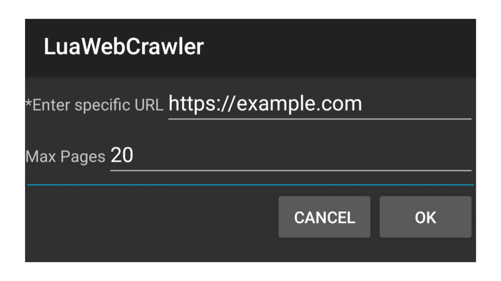

	

# 💻 Lua Web Crawler

> A web crawling tool designed to explore websites, discover URLs, and collect publicly accessible web page information. It systematically follows links within a target website to map its page structure and help developers understand how websites are interconnected.

---

## 📌 Overview

	

---

Features

- ✅ URL Discovery
- ✅ Domain Crawling
- ✅ HTML Retrieval
- ✅ Link Extraction
- ✅ Website Mapping
- ✅ Customizable Crawling

---

## 🎯 Why This Repo?

these programs:

- Finds links embedded within web pages.
- Explores pages within a specified domain.
- Fetches publicly accessible HTML content.
- Identifies internal and external links.
- Helps visualize and analyze website structures.
- Supports configurable crawling rules and depth limits.

---

## 📌 Notes

- LuaWebCrawler is built for developers, learners, and researchers interested in web technologies, automation, and website analysis.

- Use this tool responsibly. Crawl only websites you own or have permission to analyze, respect "robots.txt" and website terms, and avoid overloading servers.

---

## ⚠️ Notice

LuaWebCrawler only works by using ExecLua application.
[(Click here to download ExecLua)](https://play.google.com/store/apps/details?id=de.mlauer.luatest)

---

## 📥 Download
[Click here to download LuaWebCrawler](https://github.com/xHak1m/LuaWebCrawler/blob/main/main.lua)

---

## 📬 Contact

Feel free to connect or suggest improvements: https://github.com/xHak1m
